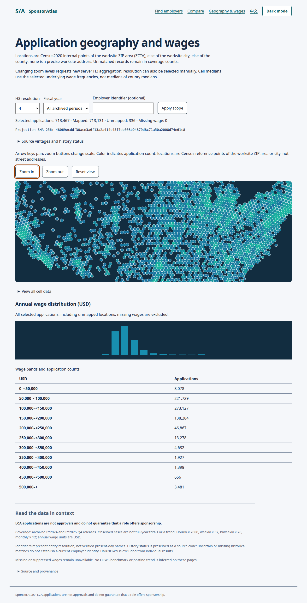

# SponsorAtlas

SponsorAtlas is a data platform and website about US employers that file H-1B Labor Condition
Applications (LCAs). It takes the Department of Labor's quarterly LCA disclosure files and USCIS
H-1B Employer Data Hub files, archives each official file by SHA-256, models them with dbt,
resolves the many spellings of one employer into a single stable employer ID, and serves the
result through a Cube semantic layer to a bilingual (English/Chinese) Next.js site with employer
search, comparison and an H3 map of worksites and wages. The goal is to answer, from official data
and with every number traceable to a source file, which employers file for H-1B workers, where,
and at what wages. Everything below ran locally on one machine on DuckDB; the cloud targets
(Snowflake, Databricks, Azure) are written but have not been run. An LCA is not a visa approval
and does not mean that a particular job offers sponsorship.



*Map page on the full-year data (local build, 2026-10-28). Cells are counts of LCA cases at
Census 2020 ZIP-area or place reference points, not worksite addresses.*

## Data flow

```text
 DOL LCA disclosure files    USCIS H-1B Employer Data Hub    BLS OEWS, Census, SOC references
            └──────────────────────────┬───────────────────────────────┘
               scripts.archive_sources: download, pin SHA-256, keep provenance (data/raw)
                                       ▼
 RAW (DuckDB) ──► dbt staging: per-release column maps, annual wages, per-fiscal-year gates
                                       │
                                       ├──► er/: Splink 5 (u/EM) on DuckDB + constrained clustering;
                                       │         employer registry archived by SHA-256 → stable IDs
                                       ▼
                 dbt marts: SCD2 employer snapshot, 4 dimensions, 3 facts with enforced contracts
                                       │
          ┌────────────────────────────┼─────────────────────────────┐
          ▼                            ▼                             ▼
  Cube 1.8 REST over a        worksite projection →          OpenMetadata 2.0.6 (local):
  Parquet export              H3 aggregation (h3-js)         column lineage RAW → marts
          └──────────────┬─────────────┘
                         ▼
   Next.js 16 site (en/zh): employer search, detail, compare, deck.gl H3 map with SVG fallback

 Orchestration: Airflow 3 + Cosmos (daily DAG tested on a synthetic source; manual fiscal-year backfill DAG)
```

## Results

All numbers come from local runs on one Linux machine (32 cores, shared with other workloads).
Each row links the raw output it was read from.

| Result | Scope | Evidence |
|---|---|---|
| 717,449 LCA rows from five official files (FY2024 Q4 120,897; FY2025 Q1 107,414, Q2 132,133, Q3 238,425, Q4 118,580); RAW and staging row counts are equal for every file | local DuckDB, files pinned by SHA-256 | [summary.json](docs/evidence/task03-uscis-release-20261029/summary.json) |
| Full-year staging build exits 0: 38 tests pass (37 data tests, 1 unit test), 7 models build. LCA FY2025 rows without a county: 6,716 of 596,552 (1.13%, limit 5%) | `make staging-actual`, 2026-10-29 | [build.log](docs/evidence/task03-uscis-release-20261029/build.log), [summary.json](docs/evidence/task03-uscis-release-20261029/summary.json) |
| USCIS rows with no state, city or ZIP are kept in staging but not released: FY2023 33,332 = 30,857 released + 2,475 excluded; FY2022 59,983 = 59,976 + 7. With them, FY2023 would fail the 5% state gate (7.44%) | same run | [end-to-end.json](docs/evidence/task03-uscis-release-20261029/end-to-end.json) |
| 717,449 LCA input rows → 713,467 cases (latest status per case number; FY2024 Q4 118,646, FY2025 594,821); 0 content mismatches between a case and its winning source row | dbt facts on DuckDB, 2026-10-28 | [fact-summary.json](docs/evidence/task09-backfill/fact-summary.json) |
| Rebuild from ER export to facts with the backfill CLI: 7 steps, all exit 0, 99.7 s; dimensions 30/30 and facts 48/48 dbt nodes pass; 98,188 employers, 713,467 cases | 2026-10-29 | [backfill-from-er_export.json](docs/evidence/task04-er-threshold-0875/backfill-from-er_export.json), [downstream-counts.json](docs/evidence/task04-er-threshold-0875/downstream-counts.json), [dbt logs](docs/evidence/task04-er-threshold-0875/backfill-logs/) |
| Entity resolution: 161,596 employer source records (from 808,282 LCA and released USCIS rows) → 98,188 employers | Splink 5, DuckDB, 1 thread, 4 GB | [input.json](docs/evidence/task04-er-threshold-0875/input.json), [prediction.json](docs/evidence/task04-er-threshold-0875/prediction.json) |
| ER accuracy on human labels, holdout of 105 pairs (55 same / 50 different) at match threshold 0.875: TP 50, FP 0, FN 5, TN 50 → precision 1.000, recall 0.909. Same at 0.80, 0.85 and 0.90. Hard-case subset (42 pairs): TP 30, FP 0, FN 3, TN 9 | 559 pairs, one reviewer; see limitations | [report.json](docs/evidence/task04-human-acceptance-20261029/report.json) |
| Employer IDs survive a rebuild: re-predicting the full year while inheriting the archived registry changes 0 of 161,596 employer IDs | 2026-10-29 | [employer-id-diff.json](docs/evidence/er-registry-archive-20261029/employer-id-diff.json) |
| Cube REST contract on the full-year Parquet export passes (9/9 as reported by node:test): all seven metrics equal an independent SQL oracle; 713,467 rows over 280,799 five-dimension groups | local Parquet, not Snowflake | [semantic-actual.log](docs/evidence/task04-er-threshold-0875/semantic-actual.log) |
| Map projection: 713,467 cases → 517,991 frequency rows (103,036,467 bytes); 336 cases unmapped; points are Census ZCTA (686,006), place (25,396) or county (1,729) internal points | 2026-10-28 | [manifest.json](docs/evidence/task14-fullyear-map/manifest.json) |
| Map frame cost: p95 of per-frame script + render time during a scripted pan/zoom over 704 H3 cells, 240 frames: 4.9 ms at 1x CPU, 9.4 ms at 4x CPU throttling (test limits 16.7 / 33 ms) | one run; Chromium via Playwright on an RTX 4090; machine load ~7. Measures work per frame, not display rate (rAF interval p95 was 33.4 ms) | [1x](docs/evidence/task14-fullyear-map/viz-frame-fy2025-full-1x.json), [4x](docs/evidence/task14-fullyear-map/viz-frame-fy2025-full-4x.json), [log](docs/evidence/task14-fullyear-map/frame-measure.log) |
| Browser E2E on the actual data: map suite 7/7; full site run 14/14, which repeats the map suite and adds keyboard-only search → detail → compare, axe checks, both locales and themes | local build, 2026-10-28 (before the 2026-10-29 ER rerun) | [viz-e2e.log](docs/evidence/task14-fullyear-map/viz-e2e.log), [site-e2e-actual.log](docs/evidence/task14-fullyear-map/site-e2e-actual.log) |
| Column lineage from the local OpenMetadata API: 25 tables, 24 table edges, 449 column edges; 5/5 checked column chains complete | local DuckDB catalogs | [summary.json](docs/evidence/task08-lineage-fy2025/summary.json), [verify-lineage.log](docs/evidence/task08-lineage-fy2025/verify-lineage.log), [lineage.svg](docs/evidence/task08-lineage-fy2025/lineage.svg) |
| CDC drill: Postgres 16 logical replication (pgoutput) → DuckDB RAW; inserts, updates and deletes on two tables all landed within 29.44 s at 30 s polling | Docker, synthetic rows, own pgoutput reader (not Airbyte) | [drill.json](docs/evidence/task02-cdc/drill.json) |
| Backfill DAG (`airflow dags test`, FY2025): load → staging → ER → dimensions ran as Airflow tasks; the run stopped at the disk-share guard before facts (20.7 GB projected, 18 GB share at the time); the fact tasks ran afterwards on their own | 2026-10-28; staging still reported the USCIS FY2023 gate failure fixed on 2026-10-29 | [summary.json](docs/evidence/task09-backfill/summary.json), [DAG log](docs/evidence/task09-backfill/airflow-dags-test-run3.log) |
| `make test` exits 0: pytest 511 passed, 8 skipped (6 live Snowflake, 1 ER acceptance, 1 Spark Connect); orchestration tests (Airflow environment) 52; Cube fixture and source tests 11 + 23; site, UI and environment tests 34 + 2 + 1; other Node tests 6 + 11 | offline suites only, 2026-10-29 | `make test` |

## Running it

Requirements: Linux x64 (developed on Ubuntu), Python 3.12 with `uv`, and Node 24.22.1 unpacked
at `.tools/node-runtime/node-v24.22.1-linux-x64` (official linux-x64 archive). Docker is needed only
for the CDC drill and OpenMetadata, a GPU only for the frame-cost test. These are the steps used on
the development machine; setup from a fresh clone has not been re-tested.

```bash
python3.12 -m venv .venv
UV_CACHE_DIR=.tools/uv-cache uv sync --frozen --extra dev --extra snowflake --extra ingestion \
  --extra staging --extra er --extra er-spark
uv venv --no-cache --python .venv/bin/python .tools/orchestration/venv
uv pip sync --no-cache --python .tools/orchestration/venv/bin/python orchestration/requirements.lock
semantic/run.sh install
bash web/scripts/bootstrap.sh

make test     # all offline suites: pytest, Airflow DAG tests, Cube on a synthetic fixture, site/UI unit tests
make check    # ruff + TypeScript typecheck
```

Live Snowflake, ER acceptance and Spark Connect tests skip unless opted in (`RUN_SNOWFLAKE_GRANTS=1`,
`RUN_SNOWFLAKE_POLICIES=1`, `SPONSORATLAS_ER_ACCEPTANCE=1`, `SPONSORATLAS_SPARK_CONNECT_TEST=1`).

Rebuilding from the official files needs them archived in `data/raw` first (not in git; see
[ingestion/README.md](ingestion/README.md)):

```bash
.venv/bin/python -m orchestration.sponsoratlas_orchestration.backfill readiness --fiscal-year 2025
.venv/bin/python -m orchestration.sponsoratlas_orchestration.backfill run --fiscal-year 2025 \
  --output <summary.json> --logs <dir>   # RAW load → staging → ER → dimensions → facts
make staging-actual        # staging build with gate and reconciliation summary
make semantic-actual       # Parquet export + Cube REST contract against an SQL oracle
make viz-worksite-export   # map projection
make viz-frame-build       # production site build for the browser tests
make viz-frame-measure     # frame-cost test (takes the GPU lock)
make viz-e2e               # map browser tests; make site-e2e-actual runs the site journeys
make cdc-drill             # throw-away Postgres container → DuckDB RAW
```

## Repository layout

| Path | Contents |
|---|---|
| `ingestion/` | release registry, Airbyte Terraform (not applied), public job-board source, Postgres CDC setup |
| `scripts/` | archiving, RAW loaders, reconciliation, reference-data builders, CDC drill, data checks |
| `dbt/` | staging, intermediate and mart models, SCD2 snapshot, tests, seeds, source contracts |
| `er/` | employer entity resolution, registry, label import and evaluation, Databricks adapter |
| `orchestration/` | Airflow 3 + Cosmos DAGs, fiscal-year backfill, isolated runtime |
| `semantic/` | Cube model, REST server wrapper, Parquet and map-projection exports |
| `web/` | `apps/site` (Next.js 16 site), `packages/ui` (design tokens and components), test scripts |
| `governance/` | private applications contract, local OpenMetadata, lineage export and checks |
| `warehouse/` | Snowflake Terraform and bootstrap notes (not applied) |
| `azure/` | Azure Data Factory pipeline and Fabric SQL/notebook port with offline tests (not provisioned) |
| `bi/` | script-generated Power BI project and Tableau workbook, reconciliation SQL |
| `data/reference/` | Census, CBSA and SOC reference files pinned by SHA-256 |
| `docs/evidence/` | raw outputs behind the results table ([index](docs/evidence/README.md)) |
| `docs/dev/` | per-task development evidence notes and the Snowflake bootstrap runbook |

## Not done and limitations

- **Cloud and native tools were not run.** Snowflake: Terraform, bootstrap SQL and the dbt target
  exist and are tested offline; nothing was applied, and the live grant and policy tests skip.
  Databricks: Spark Connect adapter and job template, never run. Azure: ADF pipeline and Fabric
  SQL/notebook with offline tests, never provisioned. Airbyte: configuration as code only; the local
  `abctl` install failed on this host (kube-proxy "too many open files") and has not been re-run.
- **BI is not met.** The Power BI and Tableau files are generated by script and were never opened in
  either tool. The five-number reconciliation matches Cube against SQL but fails for both dashboards,
  which have no values ([reconciliation.json](bi/evidence/reconciliation.json)).
- **No deployment.** No git remote, no remote CI, no public site, no real-user monitoring. The site
  runs only locally; quality gates (Lighthouse, bundle budget, visual diffs) ran locally on fixture
  data. No native Figma file exists.
- **Governance is partial.** Lineage is local; Snowflake row-access and masking policies are written
  and tested only offline; failure alerts were only drilled against a local HTTP sink. The cost report runs only
  on a fixture query history.
- **ER evaluation caveats.** The 0.875 threshold was chosen after the results on a holdout labelled
  by a sub-agent had been seen, so the holdout numbers are not an unbiased estimate. The human labels
  come from one reviewer with no second review, and the workbook's evidence column was left empty.
  The holdout is small: 105 pairs, recall 50/55, so one missed pair moves recall by about 1.8 points.
  The deployed clusters come from the unsupervised model; the model retrained with the labels gives
  identical clusters (0 of 161,596 records differ).
- **Coverage.** One full fiscal year (FY2025) plus FY2024 Q4 for LCA; USCIS FY2022–FY2023 only. The
  job-posting fact has 86 rows and says nothing about the hiring market.
- **Map.** Points are Census representative points of ZIP areas or places, not addresses. H3
  aggregation runs in the Next.js server (h3-js), not in DuckDB or Snowflake. Frame cost was measured
  once, on an RTX 4090, not on low-end hardware.
- **Site.** It shows employer identifiers, not company names (names are not in the public
  projection). Some page text still describes the coverage as "Q4 releases", although the data now
  covers FY2024 Q4 and all of FY2025.
- **Timings** are single runs on a shared machine (load averages between about 2 and 11).

The data is public. Nothing here is legal advice.
