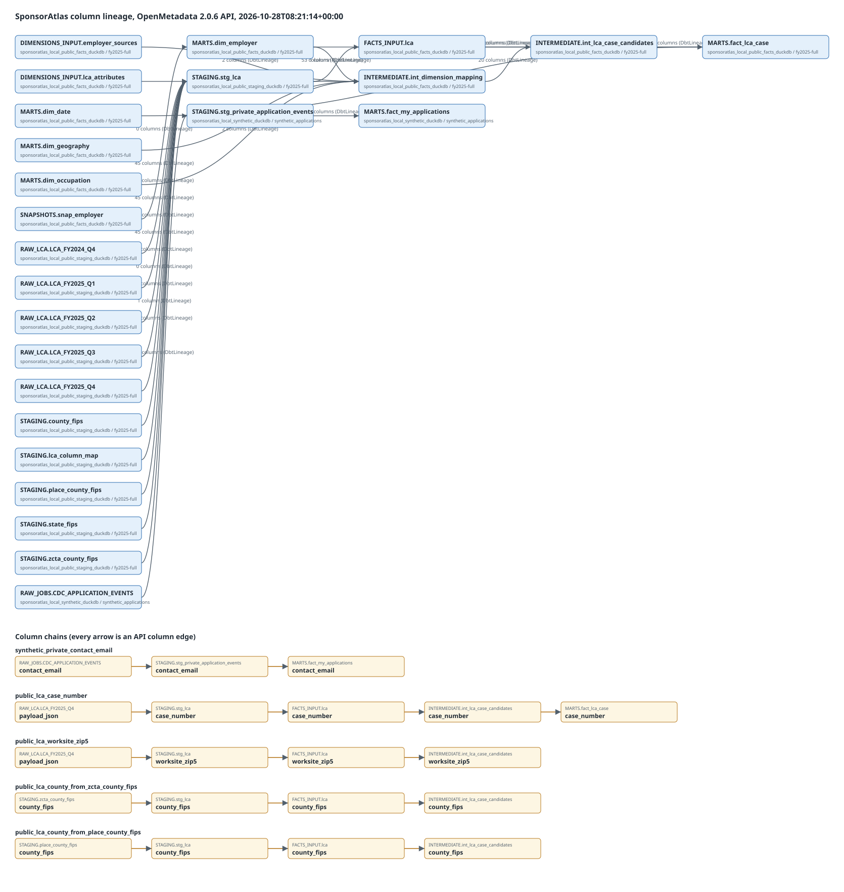

# Task8 governance evidence — 2026-10-24

## Full-year dbt lineage ingest and image (2026-10-28, phase 6)

Raw outputs in [`task08-lineage-fy2025/`](../../evidence/task08-lineage-fy2025/), OpenMetadata 2.0.6 (revision `a695261b`).

- `governance/.venv/bin/python -m governance.ingest` on the full-year artifacts:
  staging 117 dbt records / 155 OM records, **0 errors**, 19.9 s ([log](../../evidence/task08-lineage-fy2025/ingest-staging.log));
  facts 185 OM records, **0 errors**, 15.1 s ([log](../../evidence/task08-lineage-fy2025/ingest-facts.log)). The 112 / 115
  warnings are manifest models not built in that database (e.g. `dim_date` in the staging DB), as before.
- `governance.verify_lineage` now asserts **5** chains (was 2); all pass on the API edges
  ([verify-lineage.log](../../evidence/task08-lineage-fy2025/verify-lineage.log),
  [lineage-acceptance.json](../../evidence/task08-lineage-fy2025/lineage-acceptance.json)). New:
  `RAW_LCA.LCA_FY2025_Q4.payload_json → stg_lca.worksite_zip5 → FACTS_INPUT.lca.worksite_zip5 →
  int_lca_case_candidates.worksite_zip5`, and `zcta_county_fips.county_fips` / `place_county_fips.county_fips →
  stg_lca.county_fips → FACTS_INPUT.lca.county_fips → int_lca_case_candidates.county_fips`
  (test: `governance/tests/test_verify_lineage.py`).
- `governance.lineage_export --output docs/evidence/task08-lineage-fy2025`: **25 tables, 24 table edges,
  449 column edges** ([summary.json](../../evidence/task08-lineage-fy2025/summary.json)), incl. all five RAW quarters
  (FY2024 Q4, FY2025 Q1–Q4, 45 columns each) → `stg_lca`, the three county seeds (5 each) and the bridge (53).
  `fact_lca_case` has no `county_fips` column; geography reaches it as `geography_key` via `int_dimension_mapping`.
- Containers stopped with `stop -t 60` afterwards. Still an SVG of API data, not a UI screenshot.
- The four `*-lineage.json` files in that directory are now the post-ingest API responses; the
  phase-5 pre-ingest counts remain in [pre-ingest-summary.json](../../evidence/task08-lineage-fy2025/pre-ingest-summary.json).
- `make test` after this change: 615 passed, 8 skipped ([log](../../evidence/task08-lineage-fy2025/make-test-phase6.log);
  the run also contains the item-2 map-limit tests written before this commit).

## Full-year re-import (2026-10-28, phase 5) — partial

Raw outputs: [`task08-lineage-fy2025/`](../../evidence/task08-lineage-fy2025/).

- `.venv/bin/python -m governance.refresh_artifacts` copied manifest/run_results from the
  `sponsoratlas_backfill` dbt builds and generated catalogs read-only: staging 22 nodes / 14 sources,
  facts 19 nodes / 8 sources ([artifacts.json](../../evidence/task08-lineage-fy2025/artifacts.json)).
- OpenMetadata 2.0.6 (revision `a695261b`) restarted; `governance.catalog` registered
  `…public_staging_duckdb.fy2025-full` (36 tables) and `…public_facts_duckdb.fy2025-full` (27).
- `governance.bridge verify`: 53 columns, 717,449 rows, equal all-row hashes; `publish`: 53 column
  mappings `stg_lca → FACTS_INPUT.lca` ([loader-bridge.json](../../evidence/task08-lineage-fy2025/loader-bridge.json)).
- **Not done:** the official dbt ingest (`governance.ingest`) needs `governance/.venv/bin/python`,
  which this session may not run (an open blocker). The API therefore returns only the bridge edge
  for the full-year tables (6 tables, 75 column edges incl. the synthetic private chain,
  [pre-ingest-summary.json](../../evidence/task08-lineage-fy2025/pre-ingest-summary.json)). `verify_lineage` and the
  SVG were not rerun; lineage.svg still shows the Q4-only catalog.
  Containers stopped with `stop -t 60` (PG 0, ES 143, OM 143).

## Lineage image from the API (2026-10-27, phase 3)

Column lineage exported from the local OpenMetadata API

`.venv/bin/python -m governance.lineage_export --output docs/evidence/task08-lineage` ran
against the restarted local OpenMetadata **2.0.6** (revision `a695261b`) at 2026-10-27T22:04:01Z.
It saved the four raw `GET /api/v1/lineage/table/name/<FQN>` responses
(`task08-lineage/*-lineage.json`) and drew lineage.svg from them
with `governance/lineage_svg.py`: **20 tables, 19 table edges, 277 column edges**. The renderer
draws only tables and edges in those responses, and it refuses a chain step the API does not
return. Both chains passed: synthetic private `contact_email` RAW → staging → `fact_my_applications`,
and public `RAW_LCA.LCA_FY2025_Q4.payload_json` → `stg_lca.case_number` → `FACTS_INPUT.lca` →
`int_lca_case_candidates` → `fact_lca_case.case_number`. Edge counts are in
summary.json (e.g. `int_lca_case_candidates → fact_lca_case` 32
columns, the bridge `stg_lca → FACTS_INPUT.lca` 46).

Limits: the catalog still holds the dbt artifacts ingested on 2026-10-24, so the phase-3 ZIP
column of `stg_lca` is not in it yet. The image is SVG (the PNG converter needs approval here).
It is a rendering of API data, not a screenshot of the OpenMetadata UI. All three containers
were stopped with `stop -t 60` after the export.

Local governance implementation and real local catalog/API lineage are verified. **Real Snowflake RAP/masking, Snowflake metadata ingestion, actual personal CDC, and the browser lineage screenshot remain OPEN.** DuckDB results are not security-policy acceptance.

## Native RED → GREEN

- Before implementation, `pytest governance/tests/test_applications.py warehouse/tests/test_policies.py` failed: missing fixture/policy module and missing DDL macro (1 failure, 8 setup errors). After adding only the synthetic fixture, the native test failed because `MARTS.fact_my_applications` did not exist. Logs: `.tools/governance/evidence/red.txt`, `red-native.txt`.
- Final targeted regression: `.venv/bin/pytest -q governance/tests warehouse/tests scripts/tests/test_cdc_probe.py scripts/tests/test_dimension_selection.py scripts/tests/test_facts.py` → **32 passed, 6 skipped, 49.32s**. The skips are three pre-existing real Snowflake grants tests and the three new real policy tests. Log: `green-final.txt` in the same evidence directory.
- Private native dbt build → **9/9 PASS**, including source contract and application grain tests. The pytest suite also ran initial build, repeat build, full refresh, physical-event retraction, and rejection of null IDs/owners, non-owner role namespace, wrong version, and unapproved owner role. Same-job different-application IDs remain distinct; the latest application tombstone removes only its application.
- `.tools/terraform/terraform -chdir=warehouse/terraform validate` → configuration valid, **no warnings**. Provider remains 2.22.0. dbt `parse --target snowflake --no-partial-parse` passed offline. Reusable Snowflake DDL renders first-create and replacement paths with policies/tags in the creation statement. Neither validates actual remote enforcement.
- Ruff and `git diff --check` passed. The legacy staging, facts and dimensions selection tests passed without weaker assertions. Task7's public projections and Cube/Blob allowlists were unchanged.

## Strategy and live boundary

The fact is one row per stable `application_id`; `event_id` is separate. Its v2 source requires explicit approved `SPONSORATLAS_OWNER_*` roles and rejects unknown ownership. No application ID or real owner is guessed from the old source. The real Postgres contract is pending; local fixtures use fictional `synthetic-*` and `example.invalid` values. Full lifecycle and migration details are in [governance/README.md](../../../governance/README.md).

Snowflake first creation, refresh and full refresh each issue one protected CTAS. There are no data-bearing tmp/backup objects or policy post-hooks. Replacement uses COPY GRANTS. Source and private staging are restricted processing inputs; TRANSFORMER rebuilds from them and has no RAP bypass on the fact. Owner role and email are distinct policy arguments. Email plaintext requires PII_READER **and** ownership; PII_READER alone sees zero rows. Tags are bound at creation. Versioned policies use `prevent_destroy`; upgrades bind a new version before retiring the old version.

The real opt-in fixture uses six distinct JWT/key-pair users, checks actual primary/secondary memberships, checks XS/60, verifies a nonzero owner+analyst masked row, owner+PII plaintext, and zero rows for separate non-owner, PII-only and TRANSFORMER sessions. It creates and replaces a disposable table using the actual dbt macro, then drops it. No real credentials were supplied, no account was registered, and no Terraform apply or remote role grant occurred. `RUN_SNOWFLAKE_POLICIES` and `RUN_SNOWFLAKE_METADATA` remain unset. Remote metadata requires actual successful Snowflake artifacts and does not persist service connection credentials (`storeServiceConnection: false`).

## Actual OpenMetadata API results

The running local server returned version **2.0.6**, revision `a695261b19d48411a39502a5c5fc0b453729eb4e`; client **2.0.6.0** consumed genuine dbt **1.12.6** artifacts. Metadata only: no PII samples, profiler, fabricated Snowflake schema, or hand-drawn lineage.

Three separate physical local catalogs were registered under artifact-only CustomDatabase services, with actual names/case:

| Service | Physical file/catalog | Tables | Artifact directory |
|---|---|---:|---|
| `sponsoratlas_local_synthetic_duckdb` | `.tools/governance/synthetic_applications.duckdb` / `synthetic_applications` | 3 | `.tools/governance/dbt-artifacts` |
| `sponsoratlas_local_public_facts_duckdb` | `.tools/facts/actual.duckdb` / `actual` | 27 | `.tools/governance/public-facts-artifacts` |
| `sponsoratlas_local_public_staging_duckdb` | `.tools/staging/actual-files.duckdb` / `actual-files` | 25 | `.tools/governance/public-staging-artifacts` |

Each artifact directory has authentic `manifest.json`, `catalog.json`, and `run_results.json`. Public manifests/results were copied, catalogs generated through a read-only dbt profile; the 1.7GB source DB was never copied. Artifact SHA/provenance records each file. Broader manifests include unbuilt nodes; the official ingestor reported missing-catalog warnings for those nodes, with zero workflow errors. No warning was converted to an unverified lineage claim.

The actual API `GET /api/v1/lineage/table/name/<FQN>` returned these verified edges:

- Private `RAW_JOBS.CDC_APPLICATION_EVENTS` → `STAGING.stg_private_application_events`: **12 column mappings**; staging → `MARTS.fact_my_applications`: **10 column mappings**, including a continuous `contact_email` chain.
- Public `RAW_LCA.LCA_FY2025_Q4.payload_json` → `STAGING.stg_lca.case_number` → cross-file `FACTS_INPUT.lca.case_number` → `INTERMEDIATE.int_lca_case_candidates.case_number` → `MARTS.fact_lca_case.case_number`.
- The Python copy bridge is the real `create table FACTS_INPUT.lca as select * from original.STAGING.stg_lca` in `scripts/load_fact_inputs.py`. A read-only check confirmed **46 matching columns, 239,477 rows, matching all-row hash aggregates**, and source/loader SHA before API publication as PipelineLineage. It crosses distinct services; it is not an invented dbt ref or catalog self-loop. Bridge evidence.
- The `sponsoratlas-governance` team was created first and the API returned it as the private fact's dbt owner. No real individual owner was guessed.

`governance/.venv/bin/python -m governance.verify_lineage` → `PASS: two complete API column chains, real dbt owner, 3 physical local catalogs`. Checked chain and edge counts. Full API JSON and parser logs remain under `.tools/governance/evidence/`.

**UI screenshot OPEN:** CUA opened the real local sign-in page, then Chrome blocked automation because another extension UI was open. The exact tool reason was “Google Chrome is blocking automation because another extension UI is open on this page.” The controller requested dismissal; no alternate UI automation or fabricated screenshot was used. The tab was marked for handoff. The retained local stack can be restarted for the screenshot once the external UI block is removed.

## Resource, source protection and cleanup

At 19:31:45 UTC, conservative disk allocation was **17,279,154,341 bytes < 18,000,000,000**. This includes workspace file paths and symlink targets (15,493,072,671), double-counted external Docker image sizes (2 × 822,376,285, conservatively covering compressed blobs and unpacked layers), unreadable-on-host PostgreSQL data (111,234,892), writable container layers (94,208), and 30MB Docker log reserve. This project created **zero build-cache entries and zero named volumes**. The incomplete host `du` value was not used as the total.

Container hard caps are 4GiB OM, 2GiB ES, 512MiB PG, all with no swap. Observed cgroup peaks were 1,158,033,408 + 1,131,876,352 + 256,663,552 bytes. External private metadata ingestion max RSS was **371,172 KiB** with zero swaps; it is additional to container memory. Combined observed peaks are under 3GB, and service caps plus the bounded dbt/ingestion workloads remain below 16GB. PostgreSQL spill is capped at 256MiB; read-only catalog/bridge queries at 512MB RAM/128MB spill. No cloud, GPU, paid API, push, or public publish occurred.

Verified downloaded archives and the now-redundant bare Java21 runtime were removed. Root dependency lists and Task7 Node/Cube runtime were preserved. **47 protected files have identical SHA256, size and mtime before/after Task8**, including the 1.7GB actual fact DB; six public parquet exports retain the earlier controller's SHA/size (their pre-Task8 mtime changed during Task7's own rebuild).

After controller-authorized cold `.tools/uv-cache` removal, the 19:36 UTC full audit was **12,815,207,097 bytes** (the Task8 19:37 repeat was 12,811,400,745 bytes). All three project services were stopped at session end: PostgreSQL exited0, Elasticsearch143 (SIGTERM), and OpenMetadata137 after the default10-second stop timeout. Controller inspection confirmed `OOMKilled=false`. Metadata ingestion/API checks had completed and PostgreSQL shut down cleanly; retained local data/configuration supports a later screenshot restart, but restart durability was not rechecked. Use a longer stop timeout for the next session. Final service shutdown, final resource ledger and local commit are recorded in `.superpowers/sdd/4-sponsoratlas-data-frontend-plan/task-8-report.md`. Only project-specific containers are stopped; no global Docker prune, other project modification, or source overwrite was performed.

## Controller restart check — 2026-10-24 22:20–22:25 UTC

Existing project PG/ES/OM containers were restarted without image pulls, migrations, re-ingestion or source reads. PG and ES readiness and OM HTTP200 were observed. The existing `verify_lineage.verify()` ran against the real API, with only its output directory redirected to `.tools/governance/ui-restart-20261024`; both complete column chains and the dbt owner passed again. Fresh restart evidence establishes retained API state after restart, without claiming that a new catalog import occurred.

CUA reached the actual sign-in page and submitted the existing non-admin viewer login through visible semantic fields. The first stale AX-index action sent no input; current DOM locators then submitted the form. The next observation was blocked by Chrome's open extension interface, so authenticated UI success and lineage screenshots were **not observed**. A single request to dismiss the extension was sent; no alternative UI automation was used. The UI gate remains OPEN.

All three services were stopped in the same session with `docker stop -t 60`: OM143, ES143, PG0, all OOMKilled=false. All four loopback ports18532/19200/18585/18586 refused connections afterward. This records SIGTERM exits and stopped containers, not independent verification of application shutdown hooks. It avoids this run's former ten-second SIGKILL path; the deferred default-compose-grace-period maintenance finding is still open.

Observed service memory was OM1.016GiB + PG84.89MiB + ES978.8MiB, with the existing6.5GiB combined hard cap. Fresh stopped PG read-only measurement was111,861,760B allocated versus111,702,114B apparent, so the larger value is charged. The22:25:49 complete project audit is13,783,261,754B, including Task11 SDK/artifacts/Git, external Docker image/layer/log overhead and current PG; it replaces prior frozen-PG points and reserves. No new cloud/GPU or source mutation occurred. Only the retained-state API portion of the prior restart uncertainty is closed; original Snowflake/individual-source/UI requirements remain.

## Native UI follow-up, 2026-10-25

The first bounded controller attempt reached OpenMetadata2.0.6 but accidentally called a stopped-only audit guard. All3existing containers stopped; no live resource sample or UI success was obtained. Original child stderr was not retained; the guard cause is supported by the entrypoint code and phase record. The unchanged guard remains in force.

A new namespace used a controller-only live metadata audit, including max(path,allocated), PG apparent/allocated du with historical floor, Docker image double counting, retained Node layers and cgroup current/peak measurements. It ran279.76seconds with9samples; peak sampled disk15852920730B and observed separate cgroup peak sum2134929408B, under the6979321856B service cap. Existing viewer login was submitted once through normal selected Chrome UI; auth/login and auth/refresh returned401, and the page remained sign-in. The captured sign-in artwork is vendor illustration, **not project lineage**. No authenticated catalog or lineage screenshot was observed. A password-field clearing action detached and its result is unverified; no extension change, alternate browser, password reset, grant or ingestion followed.

All3containers stopped(exit0 for stop; PG0, ES143, OM143; no OOM),13project ports closed, source stat/frozen SHA checks unchanged. Latest online PG111996928B is retained as the new stopped-state historical floor; stopped directory remains unreadable and this is not a fresh full post-stop PG measurement. See attempts/actual screenshot/samples/cleanup and full post-stop audit. Existing API lineage evidence remains valid; native UI, Snowflake security and real private CDC gates remain OPEN. User was asked to check the existing private viewer credentials while independent work continues.

## Backend prerequisite verified, 2026-10-25

After preserving once3's unauthenticated policy401 and once4's pre-command directory-mtime gate failure, once5 used the existing project machine administrator through a single guarded signing-key read and exactly one four-GET business command. Version/revision, provider/cookie/role-sync/session bounds, SMTP-disabled policy and current non-admin viewer identity checks passed. No login, password/policy/permission change, browser-token injection or viewer-credential read occurred. The command took0.299s with44,830,720B sampled tree RSS and clean/reaped completion. The safe FD command and signing parity received limited independent review; prior tests were not repeated.

The original three containers stopped after140.777s; PG0/ES143/OM137, all OOM=false. OM137 is retained as the bounded stop result, not OOM. Fourteen ports were closed and no project runtime remained at the final complete point; conservative disk15,955,874,171B, with latest112,869,376B PG online historical floor retained while stopped. Azure cleanup returned group_missing for rg-sponsoratlas-lab, estimated spend$0.00 and actual bill unknown. Final backend receipt binds raw command, window and cleanup evidence.

The user confirmed file-URL access restored OFF. Keep it OFF while preparing the smallest UI prerequisite and READY handoff. Once5 is historical backend evidence, not a future UI window's live-health proof or native lineage verification. Native browser login and both visible column-lineage chains remain OPEN; Snowflake security and real private CDC also remain OPEN. No successful four-GET replay or renewed consumed lease is authorized by this result.
